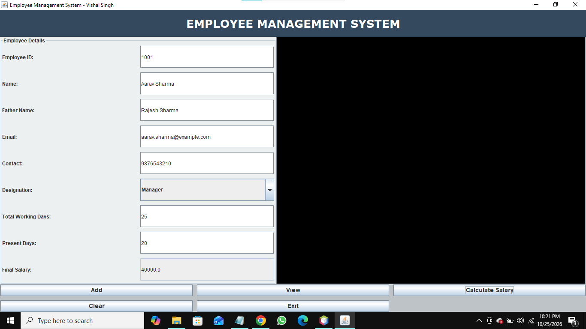
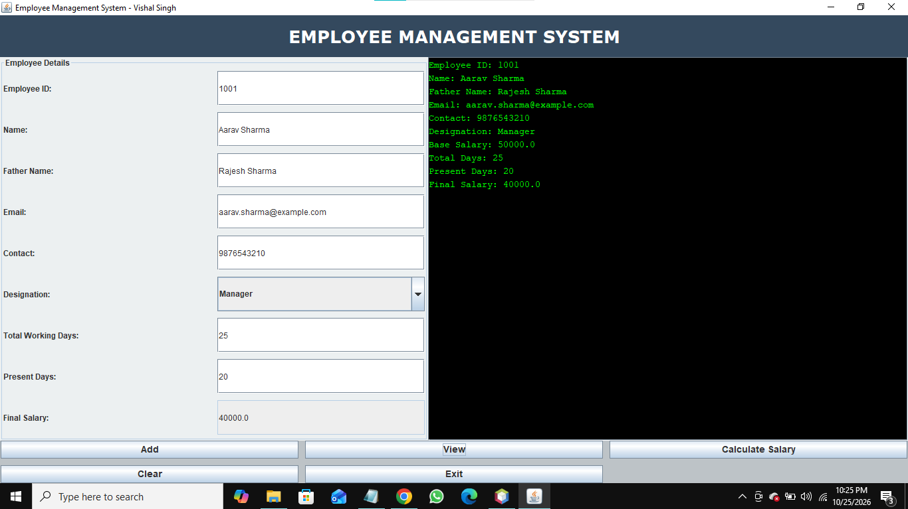

# Employee Management System

A Java Swing desktop application for managing employee details, calculating attendance-based salaries, and saving or retrieving employee records using text files.

## Features

- Add employee details, including ID, name, contact, email, and designation.
- Calculate salary based on designation and attendance.
- Save employee records to text files.
- View saved employee details using employee ID.
- Clear form fields and exit the application.

  ## Screenshots

### Salary Dashboard


### Saved Record


## Technologies Used

- Java
- Java Swing and AWT
- Event Handling
- File Handling

## How to Run

**Prerequisite:** Java Development Kit (JDK) installed.

1. Clone the repository:

   ```bash
   git clone https://github.com/vishalsingh-28R/employee-management-system-java.git
   ```

2. Open the project folder:

   ```bash
   cd employee-management-system-java
   ```

3. Compile the Java source file:

   ```bash
   javac EmployeeManagementSystemGUI.java
   ```

4. Run the application:

   ```bash
   java EmployeeManagementSystemGUI
   ```

## Project File

- `EmployeeManagementSystemGUI.java` — Contains the application interface, employee record handling, and salary calculation logic.

## Author

Vishal Singh

- GitHub: https://github.com/vishalsingh-28R
- LinkedIn: https://www.linkedin.com/in/vishal-singh-155bb8445
